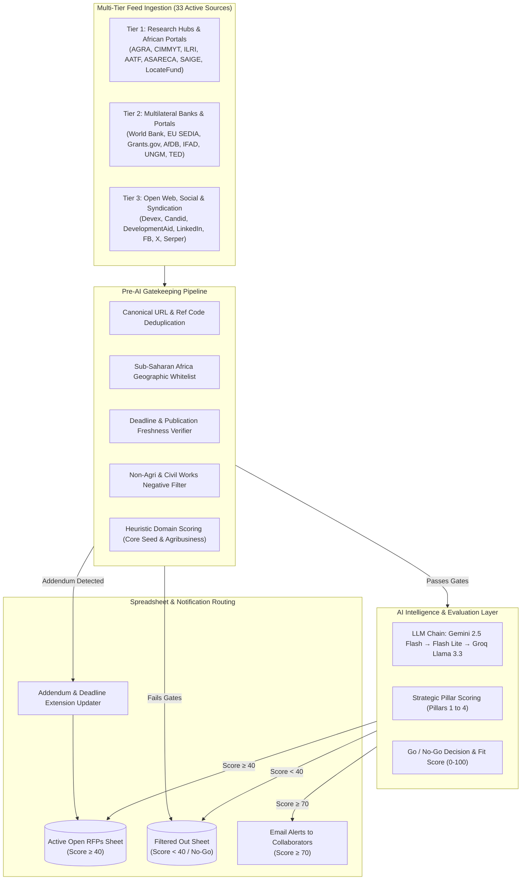

# RFP Hunter: Autonomous Multi-Feed Procurement & Grant Harvester

[](https://developers.google.com/apps-script)
[](https://ai.google.dev/)
[](#)
[-green)](#)

**RFP Hunter** is an enterprise-grade, autonomous opportunity tracking and artificial intelligence evaluation pipeline engineered for **Agri Experience Limited** (Nairobi, Kenya). Running serverlessly on Google Apps Script, it continuously monitors **33 global, regional, and institutional procurement sources**, extracts requests for proposals (RFPs), calls for expression of interest (EOIs), and grant opportunities, passes them through a high-precision multi-stage heuristic filter, and scores them against Agri Experience's core business domains using Google Gemini and Groq AI models.

---

## Architecture Overview



---

## Core Features

- **33 Ingested Feeds:** Comprehensive coverage spanning African agricultural research centers (CGIAR/ILRI, CIMMYT, AGRA, AATF, ASARECA), multilateral development banks (World Bank, AfDB, IFAD), international grant portals (EU SEDIA, Grants.gov, TED), and syndication harvesters (Devex, Candid, DevelopmentAid).
- **Zero-Cost Anti-Bot Resilience:** Overcomes Cloudflare 403 anti-bot barriers on commercial portals (Devex, DevelopmentAid, AfDB) through automated Google News RSS syndication and smart proxy fallback chains without consuming paid API search credits.
- **Strict African Geographic Whitelist:** Evaluates country references, regional economic communities (ECOWAS, EAC, SADC, COMESA), and continental scopes, systematically rejecting domestic US, European, Asian, or Latin American opportunities.
- **Dual-Threshold Relevance Filtration:** Rejects out-of-scope tenders (civil construction, roadworks, municipal hardware, heavy plant equipment, medical supplies, human clinical trials) prior to AI dispatch to protect API rate limits and execution time.
- **Addendum & Deadline Extension Detection:** Automatically maps corrigenda, addenda, and submission deadline extensions back to existing opportunities in the spreadsheet, refreshing closing dates and setting status to `OPEN (Extended)`.
- **Execution Ceiling Protection:** Built-in 310-second execution governor protects against Google Apps Script's strict 6-minute (360s) ceiling, guaranteeing clean batch commits and notification delivery.

---

## Feed Directory (33 Active Portals)

### Tier 1: Agricultural Research Centers & Continental Networks
1. **AGRA (Alliance for a Green Revolution in Africa):** Oracle Procurement Cloud abstract scraper and opportunities feed.
2. **CIMMYT (International Maize and Wheat Improvement Center):** Careers, consultancies, and RFP page scraper.
3. **ILRI (International Livestock Research Institute):** Consultancies and procurement notices (Nairobi campus & continental).
4. **AATF (African Agricultural Technology Foundation):** Tenders and consultancies portal scraper.
5. **ASARECA (Association for Strengthening Agricultural Research in Eastern and Central Africa):** WordPress REST API.
6. **FundsforNGOs:** African agricultural development, climate, and grant opportunities API.
7. **Global South Opportunities:** RSS funding feed.
8. **LocateFund:** Dedicated African funding opportunities crawler with XML sitemap parsing.
9. **SAIGE Africa Opportunity Platform:** Multi-family opportunities and market-linkage scraper.
10. **TenderSure Africa:** Public tenders and prequalification portal scraper.

### Tier 2: Multilateral Banks & Global Procurement Portals
11. **World Bank Procurement API:** Global notices filtering Sub-Saharan Africa project procurement.
12. **World Bank Projects & Operations Pipeline:** Active and approved project pipeline API (`search.worldbank.org/api/v2/projects`).
13. **EU Funding & Tenders Portal (SEDIA Grants):** Horizon Europe & Global Europe REST API (`api.tech.ec.europa.eu`).
14. **EU TED (Tenders Electronic Daily) Search API:** Official European procurement notices.
15. **Grants.gov US Federal Funding (Simpler Grants):** REST Search API monitoring USAID, USDA-FAS, and DOS African assistance solicitations.
16. **African Development Bank (AfDB) Requests for EOI:** Document repository scraper with automated RSS fallback.
17. **AfDB Corporate Procurement & Solicitations:** Headquarters and regional office corporate procurement notices.
18. **AfDB Invitations for Bids (IFB):** Project-related international competitive bidding solicitations.
19. **IFAD (International Fund for Agricultural Development):** African project procurement and calls for proposals parser.
20. **UNGM (United Nations Global Marketplace):** Direct procurement notices (FAO, WFP, IFAD, UNEP, UNICEF).
21. **UNJobNet:** Consultancies and individual contract notices parser.
22. **AllBusiness Africa:** Pan-African tender aggregation API.
23. **Africa-Europe Innovation Platform (AEIP):** Food systems and agricultural innovation funding portal.

### Tier 3: Open Web, Social Media & Paywall-Bypassing Syndication
24. **Devex Funding & Tender Harvester:** Zero-cost syndication bypassing Cloudflare 403 / paywall.
25. **Candid & Foundation Center Philanthropy Harvester:** Tracks philanthropic grant RFPs (Gates, Rockefeller, Mastercard Foundation).
26. **DevelopmentAid Opportunities & Grants:** Zero-cost RSS syndication for tenders and grants.
27. **Gavi Opportunities & CSO Funding Harvester:** Tracks UNGM and institutional procurement consultancies.
28. **Social Media Opportunities (LinkedIn Posts):** Real-time RSS harvester for donor and NGO RFP announcements.
29. **Social Media Opportunities (Facebook):** Organizational grant calls and tender notices via RSS.
30. **Social Media Opportunities (X / Twitter):** Procurement tweets and EOI links via RSS.
31. **Google Open Web Search (Serper API):** High-precision dynamic search queries for emerging agricultural RFPs.
32. **AGRA Oracle Cloud Backend:** Direct procurement negotiation harvester.
33. **LocateFund Sitemap Ingestion:** Deep crawling of published opportunity records.

---

## Strategic Pillar Evaluation Matrix

Incoming candidates that pass pre-AI heuristic filters are evaluated against Agri Experience's four core capability pillars:

| Pillar | Strategic Focus Areas | Representative Keywords |
| :--- | :--- | :--- |
| **Pillar 1: Seed Systems & Variety Commercialization** | Early generation seed (EGS), certified seed, quality declared seed (QDS), variety release, DUS/NPT trials, seed certification, seed inspection, community seed banks, local seed enterprises. | `seed systems`, `early generation seed`, `certified seed`, `variety release`, `breeder seed`, `seed inspection`, `ISTA`, `OECD seed` |
| **Pillar 2: AgTech, Advisory & Digital Extension** | Digital farmer advisory services, e-extension, seed traceability systems, scratch-off authentication, agricultural mobile platforms, digital farmer registries, e-voucher subsidy systems. | `agtech`, `digital advisory`, `e-extension`, `traceability`, `scratch-off labels`, `farmer registry`, `e-voucher`, `agritech` |
| **Pillar 3: Agricultural Policy, Law & Biosafety** | Seed law reform, regional seed harmonization (COMESA, ECOWAS, EAC), plant variety protection (PVP/UPOV), biosafety regulations, GMO/biotech frameworks, phytosanitary/SPS compliance. | `seed policy`, `seed law`, `PVP`, `plant breeders rights`, `UPOV`, `biosafety`, `SPS agreements`, `regulatory reform` |
| **Pillar 4: Value Chain, Agribusiness & MSD** | Market systems development (MSD), agro-dealer development, input supply chains, farmer capacity building, youth and women in agribusiness, post-harvest management, agricultural trade. | `agribusiness`, `market systems development`, `agrodealer`, `value chain`, `capacity building`, `training of trainers`, `farmer training` |

---

## Configuration & Environment Variables

The script is configured via Google Apps Script **Script Properties** (`Project Settings > Script Properties`):

| Property Name | Required | Description |
| :--- | :---: | :--- |
| `GEMINI_API_KEY` | **Yes** | Primary API key for Google Gemini Flash models. |
| `GROQ_API_KEY` | Optional | Secondary/fallback API key for Groq Llama 3.3 70B. |
| `SERPER_API_KEY` | Optional | API key for Google Serper web search (conserved by RSS fallbacks). |
| `SCRAPINGANT_API_KEY` | Optional | Browser rendering proxy key for JavaScript-heavy dynamic portals. |
| `SCRAPERAPI_KEY` | Optional | Secondary proxy rendering key. |
| `CRAWLBASE_JS_TOKEN` | Optional | Tertiary proxy rendering token. |
| `ALERT_RECIPIENT_OVERRIDE` | Optional | Overrides sheet collaborator emails for system alerts. |

---

## Deployment & Setup Instructions

1. **Create or Open a Google Sheet:**
   - Create a Google Sheet to serve as the master dashboard.
   - Name the primary tab `Active Open RFPs` and the secondary tab `Filtered Out (Not Genuine RFPs)`.
2. **Open Apps Script Editor:**
   - Navigate to `Extensions > Apps Script`.
   - Copy the entire contents of [`RFP Hunter.js`](file:///c:/Users/User/OneDrive%20-%20Agri%20Experience%20Limited/Coding/RFP%20Hunter.js) into the script editor (replacing `Code.gs`).
3. **Set Script Properties:**
   - Go to `Project Settings (Gear Icon) > Script Properties`.
   - Add your `GEMINI_API_KEY` and optional fallback keys.
4. **Initialize Master Dashboard:**
   - In the Apps Script toolbar, select `initializeTrackerSheets` and click **Run**.
   - Grant the necessary Google Workspace permissions (Spreadsheets, Mail, UrlFetch).
5. **Set Up Automated Time-Driven Triggers:**
   - Go to `Triggers (Clock Icon) > Add Trigger`.
   - Function: `runRfpTrackerV4`.
   - Event Source: `Time-driven`.
   - Type: `Day timer` (e.g., daily between 6:00 AM and 7:00 AM) or `Hour timer` (every 12 hours).

---

## Testing & Local Simulation Suite

The repository includes a dedicated test and verification suite in `scratch/`:

```bash
# Verify syntax, bracket balancing, and non-listing regex integrity
node scratch/verify_script_integrity.js

# List all 33 configured feeds and their operational types
node scratch/list_all_feeds.js

# Test live feed ingestion and network connectivity
node scratch/test_new_feeds_live.mjs

# Execute comprehensive multi-metric rejection & acceptance inspection
node scratch/inspect_new_sources_rejection.mjs
```

---

## License & Ownership

Developed for **Agri Experience Limited** (Nairobi, Kenya). All rights reserved. Designed for proprietary agricultural business intelligence, procurement discovery, and seed system transformation.
